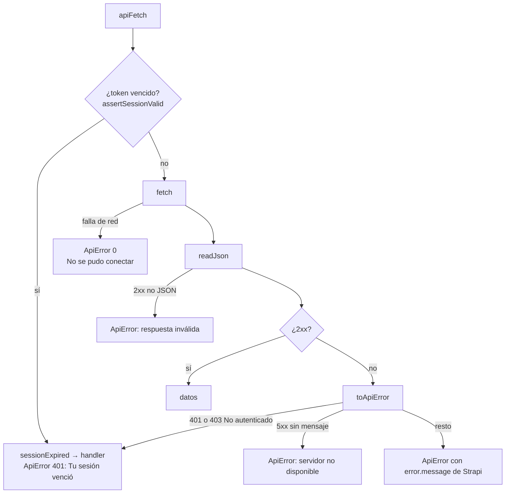

## Cliente HTTP: `apiFetch` {/* #cliente-http-apifetch */}

`src/api/client.ts` centraliza las llamadas JSON a Strapi; `upload.ts` reutiliza sus piezas para el envío multipart.

```ts title="src/api/client.ts (firma)"
apiFetch<T>(path: string, options?: {
  method?: "GET" | "POST" | "PUT" | "DELETE";
  body?: unknown;                 // JSON.stringify
  token?: string | null;          // Authorization: Bearer <token>
  query?: Record<string, string | number | boolean | undefined>;
}): Promise<T>
```

Flujo:



| Pieza | Responsabilidad |
|---|---|
| `API_BASE_URL` | `EXPO_PUBLIC_API_BASE_URL` o producción; única definición |
| `assertSessionValid(token)` | Corta antes de la red si el `exp` del JWT ya pasó (`src/utils/jwt.ts`, margen de 60 s) |
| `readJson(response)` | Parsea sin romper con HTML (p. ej. un 502 del proxy) |
| `toApiError(response, data, token)` | Traduce el error; detecta sesión inválida |
| `setSessionExpiredHandler(fn)` | `AuthContext` registra qué hacer al vencer la sesión |

¿Por qué también 403? Con un token vencido, la estrategia `billy-jwt` no autentica y el controlador responde `ctx.forbidden("No autenticado")`. Un 403 por otro motivo no cierra la sesión.

`ApiError` tiene `message`, `status` (0 = red) y `details`. `errorMessage(e, fallback)` devuelve el mensaje solo si es un `ApiError`.

## `useQuery` {/* #carga-de-datos-usequery */}

```ts
const { data, setData, status, error, refreshing, refresh, reload } = useQuery(fetcher, deps, enabled);
```

- `status`: `loading` → `success` | `error`. Un refresh fallido conserva los datos.
- El *fetcher* más reciente se guarda en un ref actualizado en `useLayoutEffect` (sin incluirlo en `deps`).
- Sin caché entre pantallas.

`useDebouncedValue(value, delay)` retrasa un valor (búsquedas: 350 ms).

## `usePaginatedQuery` {/* #usepaginatedquery */}

`src/hooks/usePaginatedQuery.ts`, para listados de Strapi:

```ts
const list = usePaginatedQuery((page) => listInvoices(token!, { search, etapa, sort, page }), [token, search, etapa, sort], !!token);
// list.items, total, status, error, refreshing, hasMore, loadingMore, loadMoreError, loadMore, refresh, reload
```

- Acumula páginas; `hasMore = page < pageCount`.
- Cada carga lleva un número de petición: las respuestas de filtros anteriores se descartan.
- Al cambiar los filtros se cancela visualmente una "siguiente página" en curso.
- `LoadMoreFooter` muestra spinner, error con reintento o el botón **Cargar más**.

## `useBillyConfig` {/* #usebillyconfig */}

Envuelve `useQuery(getMyConfig)` y agrega `save(data)`: `PUT` si existe `documentId`, `POST` si no. **Ambos piden el mismo `populate` que el `GET`** (el `update` del core de Strapi 5 respeta el `populate` de la query), así que la respuesta reemplaza la configuración en memoria sin perder tonos ni imágenes.

## `AuthContext`

| Valor | Descripción |
|---|---|
| `user`, `token` | Usuario recortado (`toSessionUser`) y JWT |
| `isLoading` | Restaurando la sesión al arrancar |
| `sessionExpired` | La sesión se cerró sola; el ingreso muestra un aviso |
| `login`, `logout`, `forgetDevice` | Ver [Autenticación](../funcionalidades/autenticacion.md) |
| `biometricLogin()` | `Promise<boolean>` |
| `updateUser(patch)` | Actualiza `user` en memoria y SecureStore |

## Feedback al usuario

| Situación | Mecanismo |
|---|---|
| Error de carga | `ErrorState` con **Reintentar** |
| Error de formulario | `Banner` o `error` del `TextField` |
| Resultado de una acción | `useToast().show(…)` |
| Confirmación destructiva | `ConfirmSheet` |
| Errores de biometría | `Alert.alert` |
