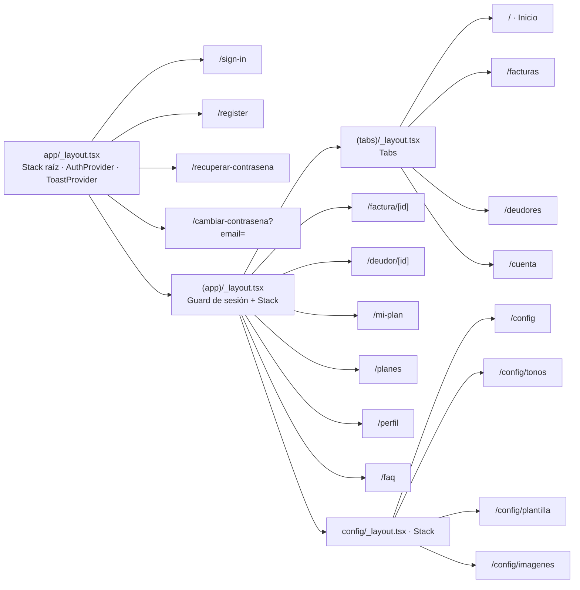
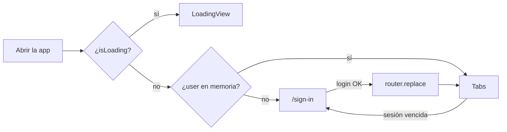

# Navegación y rutas

La navegación usa **expo-router**: cada archivo de `app/` es una ruta. Los grupos entre paréntesis (`(app)`, `(tabs)`) organizan layouts sin aparecer en la URL.

## Árbol de layouts



## Rutas

| Ruta | Archivo | Acceso | Propósito |
|---|---|---|---|
| `/sign-in` | `app/sign-in.tsx` | Pública | Ingreso con contraseña o biometría |
| `/register` | `app/register.tsx` | Pública | Crear cuenta |
| `/recuperar-contrasena` | `app/recuperar-contrasena.tsx` | Pública | Pedir código OTP |
| `/cambiar-contrasena` | `app/cambiar-contrasena.tsx` | Pública | Validar OTP y fijar nueva contraseña. Parámetro `email`. |
| `/` | `app/(app)/(tabs)/index.tsx` | Sesión | Inicio (dashboard) |
| `/facturas` | `app/(app)/(tabs)/facturas.tsx` | Sesión | Listado de facturas |
| `/deudores` | `app/(app)/(tabs)/deudores.tsx` | Sesión | Listado de deudores |
| `/cuenta` | `app/(app)/(tabs)/cuenta.tsx` | Sesión | Perfil, plan, ajustes, cierre de sesión |
| `/factura/[id]` | `app/(app)/factura/[id].tsx` | Sesión | Detalle de factura (`id` = `documentId`) |
| `/deudor/[id]` | `app/(app)/deudor/[id].tsx` | Sesión | Detalle de deudor (`id` = `documentId`) |
| `/mi-plan` | `app/(app)/mi-plan.tsx` | Sesión | Plan, saldo e historial de créditos |
| `/planes` | `app/(app)/planes.tsx` | Sesión | WebView de recarga |
| `/perfil` | `app/(app)/perfil.tsx` | Sesión | Editar nombre, razón social y NIT |
| `/faq` | `app/(app)/faq.tsx` | Sesión | Centro de ayuda |
| `/config` | `app/(app)/config/index.tsx` | Sesión | Ajustes generales de cobranza |
| `/config/tonos` | `app/(app)/config/tonos.tsx` | Sesión | Tonos y canales |
| `/config/plantilla` | `app/(app)/config/plantilla.tsx` | Sesión | Plantilla de correo |
| `/config/imagenes` | `app/(app)/config/imagenes.tsx` | Sesión | Cabecera, firma y avatar |

Con el esquema `billy-app`, las rutas son direccionables como deep link (por ejemplo `billy-app://facturas`). No hay manejo explícito de deep links entrantes ni de notificaciones que naveguen a una pantalla.

## Protección del área autenticada {/* #proteccion */}

`app/(app)/_layout.tsx` es el único guard:

```tsx title="app/(app)/_layout.tsx"
const { user, isLoading } = useAuth();
if (isLoading) return <LoadingView />;          // restaurando sesión de SecureStore
if (!user) return <Redirect href="/sign-in" />; // sin sesión en memoria
```



Consecuencias:

- Con una sesión guardada **vigente**, `AuthProvider` la restaura sin pedir biometría y entra a las tabs; si venció, la borra y el ingreso muestra "Tu sesión venció" ([Autenticación](../funcionalidades/autenticacion.md#restauracion-de-sesion)).
- Si una petición detecta la sesión vencida, `AuthContext` pone `user` en `null` y este mismo guard redirige a `/sign-in`, desde cualquier pantalla.
- Las rutas públicas no redirigen a `/` si ya hay sesión.

## Tabs

`app/(app)/(tabs)/_layout.tsx` usa `Tabs` de `expo-router/js-tabs` con cuatro destinos fijos, ícono y etiqueta siempre visibles:

| Tab | Ícono (lucide) | Color activo / inactivo |
|---|---|---|
| Inicio | `House` | `colors.primary` / `colors.textTertiary` |
| Facturas | `FileText` | ídem |
| Deudores | `Users` | ídem |
| Cuenta | `CircleUserRound` | ídem |

Altura de la barra: 84 px en iOS, 64 px en Android; grosor de trazo del ícono 2 activo, 1,75 inactivo.

## Navegación programática

Se usa `router` de `expo-router`:

| Patrón | Ejemplo |
|---|---|
| Ir a un detalle | `router.push({ pathname: "/factura/[id]", params: { id: invoice.documentId } })` |
| Reemplazar tras login/logout | `router.replace("/")`, `router.replace("/sign-in")` |
| Volver | `NavHeader` usa `router.back()` si puede; si no, `router.replace("/")` |
