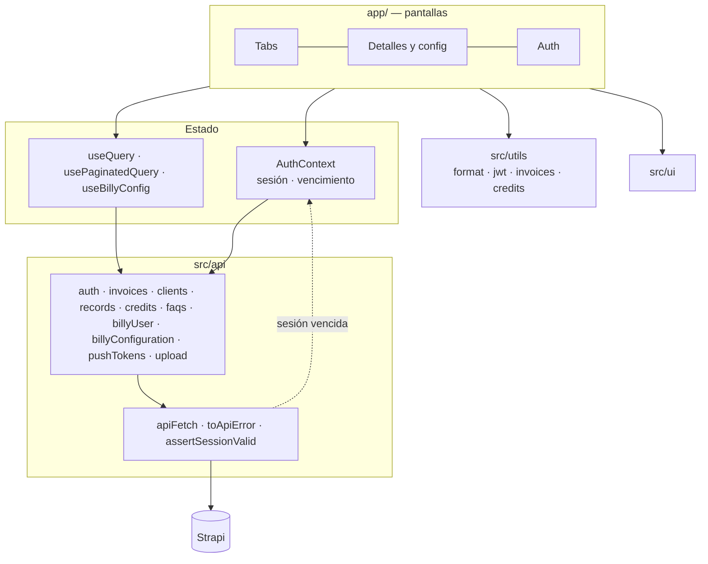

BillyApp es una app **Expo + React Native** con enrutamiento por archivos (`expo-router`). El único estado global es la sesión; cada pantalla carga sus datos de Strapi con `useQuery` o `usePaginatedQuery` y los muestra con el sistema de diseño propio (`src/ui`).

## Ecosistema

| Pieza | Repositorio | Rol |
|---|---|---|
| App móvil | `billy-app` | Consulta y configuración desde el teléfono |
| Backend | `gcp-strapi-billy` (Strapi 5.33.4) | Datos, autenticación, programación de cobros, push |
| Web | `Billy_v2` (PHP) | Todo lo de la app, más campañas, audiencias, integraciones y compra de planes |
| Servicio de envío | Externo (GCP) | Envía los mensajes de cobro |

Detalle en [Integraciones](../integraciones.md).

## Stack de la app

| Capa | Tecnología | Versión |
|---|---|---|
| Runtime | Expo SDK | `~57.0.28` |
| UI nativa | React Native / React | `0.86.3` / `19.2.3` |
| Lenguaje | TypeScript `strict` | `~6.0.3` |
| Navegación | `expo-router` (Stack + `expo-router/js-tabs`) | `~57.0.26` |
| Sesión y biometría | `expo-secure-store`, `expo-local-authentication` | SDK 57 |
| Push | `expo-notifications` | `~57.0.22` |
| Imágenes / pago | `expo-image-picker`, `react-native-webview` | — |
| Íconos / fuente | `lucide-react-native` (+ `react-native-svg`), Plus Jakarta Sans | — |
| Animación (transitiva) | `react-native-reanimated`, `react-native-worklets` | Las requiere el *drawer* de `expo-router` |
| Calidad | Jest (`jest-expo`), ESLint (`eslint-config-expo`) | [Calidad](../calidad.md) |

## Estructura

```text
billy-app/
├── app/                      # Rutas (expo-router)
│   ├── _layout.tsx           # Fuentes, splash, AuthProvider, ToastProvider
│   ├── sign-in.tsx, register.tsx, recuperar-contrasena.tsx, cambiar-contrasena.tsx
│   └── (app)/                # Área autenticada (guard)
│       ├── (tabs)/           # Inicio, Facturas, Deudores, Cuenta
│       ├── factura/[id].tsx, deudor/[id].tsx
│       ├── config/           # Cobranza automática
│       └── mi-plan.tsx, planes.tsx, perfil.tsx, faq.tsx
├── src/
│   ├── api/                  # Cliente HTTP + un módulo por recurso (+ __tests__)
│   ├── context/AuthContext.tsx
│   ├── hooks/                # useQuery, usePaginatedQuery, useBillyConfig
│   ├── ui/                   # Billy Design System
│   ├── components/           # InvoiceRow, GroupedRow, BrandMark
│   ├── utils/                # format, jwt, invoices, credits, authUtils, push (+ __tests__)
│   └── testing/              # Utilidades de prueba
├── assets/ · docs/GOOGLE_PLAY_CONSOLE.md
├── app.json · app.config.js · eas.json · babel.config.js · tsconfig.json
└── eslint.config.js · jest.global-setup.js
```

## Capas



## Decisiones técnicas

1. **La app llama directamente a Strapi**; la autorización es por dueño en el backend ([Seguridad](../seguridad.md#autorizacion)).
2. **Sin librería de datos** (Redux, React Query): `useQuery` y `usePaginatedQuery` dan estados, refresh, reintento y descarte de respuestas obsoletas. Por eso hay avisos de `set-state-in-effect`.
3. **Listados paginados con filtros en el servidor**, sin filtrar nunca por `client` (lo pisa el filtro de dueño).
4. **La sesión vence sola:** se lee el `exp` del JWT, y un 401 o un 403 "No autenticado" cierran la sesión en un único punto (`apiFetch` → `AuthContext`).
5. **La biometría no crea sesiones:** solo desbloquea un JWT vigente. No se pide al abrir la app (decisión de producto).
6. **`expo-notifications` se carga con `require` diferido** para no romper Expo Go Android.
7. **Plantilla como texto plano**, con las mismas variables y el mismo formato que la web.
8. **Recarga por WebView** a la web existente.
9. **Lógica pura en `src/utils`** (`dueLabel`, `creditState`, `parseDate`, `jwt`) para poder probarla sin UI.
10. **CNG:** `android/` e `ios/` se generan y no se versionan.
