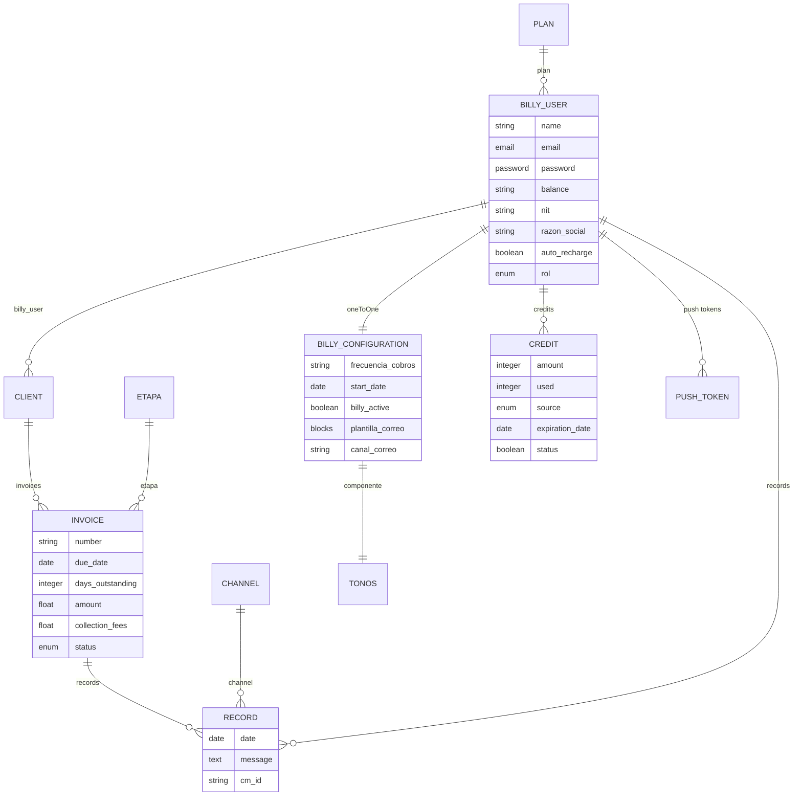

Los datos viven en Strapi v5 (`gcp-strapi-billy`, `src/api/*/content-types/*/schema.json`). La app no tiene base de datos ni migraciones propias. Aquí se incluyen las entidades que la app usa o afectan a su funcionamiento.

## Persistencia

| Dónde | Qué | Ver |
|---|---|---|
| Strapi (`DATABASE_CLIENT`: Postgres con `pg`, SQLite por defecto en local) | Todo el dominio | [API del backend](./api-backend.md) |
| Redis | Programación de cobros (BullMQ), locks, "hecho hoy" | [Integraciones](../integraciones.md#cron) |
| SecureStore (dispositivo) | `billy_token`, `billy_user` (recortado) | [Autenticación](../funcionalidades/autenticacion.md#almacenamiento) |

## Identificadores

- `documentId` (string): rutas de la app (`/factura/[id]`), `GET` y `PUT` por documento.
- `id` (número): para asignar medios (`{ cabecera_correo: <id> }`) y en el JWT (`{ id, email }`).

## Diagrama entidad-relación

Tipos de relación tal como están declarados en los esquemas:



:::info[Relaciones corregidas a `manyToOne`]
`invoice.etapa`, `record.channel`, `client.billy_user` y `billy_user.plan` estaban declaradas `oneToOne` pese a ser muchos-a-uno (muchas facturas comparten una etapa, muchos *records* un canal, un usuario tiene muchos deudores, muchos usuarios comparten un plan). Se corrigieron a `manyToOne` en `gcp-strapi-billy` (commit `d389e97`). El cambio se verificó contra una copia de la base de desarrollo: la tabla de relación (mismo nombre, mismas columnas en ambos tipos porque ninguna de las cuatro usaba `useJoinTable: false`) conserva sus filas byte a byte al reiniciar Strapi con el esquema nuevo — no debería perderse ninguna relación existente. Conviene igual una corrida de verificación contra una copia de Postgres de *staging* antes de desplegar a producción, ya que el *diffing* de esquema de Strapi se comporta distinto según el motor.
:::

## Entidades

### billy-user {/* #billyuser */}

| Atributo | Tipo (esquema) | Uso en la app |
|---|---|---|
| `name`, `nit`, `razon_social` | string | Perfil (editable) |
| `email` | email | Login (el backend lo pasa a minúsculas) |
| `password` | password (bcrypt) | Nunca se lee |
| `balance` | **string** | Saldo; la app lo convierte con `Number()` |
| `plan` | relación a `plan` | `populate[0]=plan` |
| `auto_recharge` | boolean | Tipado, sin uso |
| `credits`, `records`, `campaigns`, `audiences`, `integrations`, `notifications`, `transactions` | relaciones | La app solo usa `credits` y `records` vía sus endpoints |
| `rol`, `hubspot_id`, `id_sub`, `customer_id` | varios | No los usa la app |

### plan

`name`, `credits`, `price`, `unit` e `isSuscription` (`true` → saldo "Ilimitado"). La web compara además el nombre `"Suscripción  Ilimitada"` (con doble espacio) en su dashboard.

### billy-configuration {/* #billyconfiguration */}

| Atributo | Tipo | En la app | En el backend |
|---|---|---|---|
| `canal_correo`, `link_pago`, `link_drive` | string | Editable | Enviado al servicio de envío |
| `frecuencia_cobros` | string | Editable (dígitos) | Intervalo del programador |
| `start_date` | **date** | **No editable** | Obligatorio para programar cobros |
| `billy_active` | boolean | No editable | `false` → no se cobra |
| `test_email`, `test_phone`, `test_whatsapp` | string | Editable | Enviado |
| `client_type` | boolean | Editable | Enviado |
| `tonos` | componente | Editable | Enviado (`con_plantilla` sin WhatsApp ni notas) |
| `plantilla_correo` | blocks | Editable como texto | Enviado tal cual |
| `cabecera_correo`, `firma_correo`, `avatar_billy` | media | Subida | Se envía solo el `id` |
| `canal_sms`, `copymessage` | string / boolean | No | Enviados |
| `fee_collection` | string | No | No se envía |

Componente `Tono`: `active`, `canales { email, sms, whatsapp }`, `filters`, `notas`.

### client · invoice · etapa

- `client`: `name`, `email`, `invoices`. Dueño: `billy_user`.
- `invoice`: `number`, `due_date` (**date**), `days_outstanding` (integer), `amount` y `collection_fees` (float), `status` (enumeración), `etapa`, `client`, `records`. Dueño: `client.billy_user`.
- `etapa`: colección global con `name`.

### record

Un mensaje de cobro enviado: `date` (**date**), `message`, `cm_id`, `invoice`, `channel`, `billy_user`. Los crea el flujo de envío (rutas masivas `create-bulk-entries` y otras).

### credit {/* #credit */}

Lote de créditos (libro de créditos, `gcp-strapi-billy` commit `d389e97`):

| Atributo | Tipo | Notas |
|---|---|---|
| `amount` | integer | Total acreditado en el lote |
| `used` | integer, por defecto 0 | Mensajes ya consumidos; disponible = `amount − used` |
| `source` | enum: `purchase` \| `gift` \| `adjustment` \| `migration` | Por defecto `purchase` |
| `expiration_date` | date | — |
| `status` | boolean, por defecto `true` | `false` = ya no usable: agotado (`used = amount`) o vencido (job `credits-expire`) |
| `billy_user` | relación `manyToOne` | — |

Detalle funcional en [Cuenta y plan](../funcionalidades/cuenta-y-plan.md#libro-de-creditos).

### otp · push-token · cron-log

- `otp`: `code`, `email`, `phone`, `expires_at` (5 minutos), `used`.
- `push-token`: `token`, `device_type`, `billy_user`.
- `cron-log`: `config_id`, `executed_at`, `status` (`success` / `http_error` / `error`), `http_status`, `error_message`.

### faq

`Pregunta`, `Respuesta`.

## Formato de respuesta

```ts title="src/api/types.ts"
interface StrapiListResponse<T> {
  data: T[];
  meta: { pagination: { page: number; pageSize: number; pageCount: number; total: number } };
}
```

Las fechas `date` llegan como `"YYYY-MM-DD"` y la app las interpreta como fecha local (`parseDate`).
