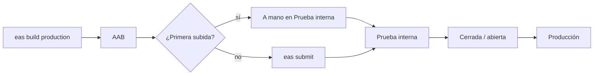

## Entornos

| Entorno | API | Cómo |
|---|---|---|
| Desarrollo | `.env` o producción por defecto | `npm run android` / `npm start` |
| Builds internos | Variable en EAS | `eas build --profile development \| preview` |
| Producción | `https://billyadmin.oblicua.co/api` | `eas build --profile production` |

## Antes de compilar

```bash
npm run check   # tipos + lint + 46 pruebas
```

## Perfiles de EAS

| Perfil | Salida | Comando |
|---|---|---|
| `development` | Development build | `eas build --profile development --platform android` |
| `preview` | APK interno | `eas build --profile preview --platform android` |
| `production` | AAB / IPA, `autoIncrement` | `eas build --profile production --platform android` |

### Variables y archivos en EAS {/* #variables-en-eas */}

EAS sube solo lo versionado: `.env` y `google-services.json` **no llegan al build** y hay que cargarlos en EAS:

```bash
# URL de la API por entorno (opcional: por defecto es producción)
eas env:set --name EXPO_PUBLIC_API_BASE_URL --value https://billyadmin.oblicua.co/api \
  --visibility plaintext --environment production

# Firebase (FCM) como variable de tipo archivo; EAS expone su ruta y app.config.js la lee
eas env:set --name GOOGLE_SERVICES_JSON --type file --value ./google-services.json \
  --visibility secret --environment production --environment preview --environment development
```

Para que las push lleguen en Android también hay que cargar las credenciales **FCM V1** en EAS (`eas credentials`). Estos comandos no se han ejecutado: falta configurarlo en la cuenta `jdd95`. Sin `GOOGLE_SERVICES_JSON`, EAS avisa en cada build que el `googleServicesFile` no está versionado y no se subirá.

## Versionado

| Campo | Dónde | Quién |
|---|---|---|
| `version` | `app.json` (`1.0.0`) | A mano |
| `android.versionCode` | `app.json` (`3`) | EAS (`autoIncrement`, `appVersionSource: local`) |
| `ios.buildNumber` | No definido | EAS en el primer build iOS |

EAS **modifica `app.json`** al incrementar: hay que confirmar ese cambio en git.

## Firma

- **Android:** Play App Signing; EAS crea y guarda la clave de subida. Respaldo con `eas credentials`.
- **iOS:** gestionada por EAS con la cuenta de Apple Developer (sin verificar).

## Publicación en Google Play

Guía completa en `billy-app/docs/GOOGLE_PLAY_CONSOLE.md`.



Antes de enviar:

- Usuario de revisión con datos de muestra que no dispare envíos reales. Ojo: guardar su configuración reprograma cobros.
- Política de privacidad que cubra push, biometría, galería y MercadoPago.
- Formularios de contenido (*Data safety*, clasificación, 18+).
- Revisar en el *App bundle explorer* que no aparezcan `RECORD_AUDIO`, `SYSTEM_ALERT_WINDOW` ni `AD_ID`.
- `submit.production` vacío en `eas.json`: agregar `serviceAccountKeyPath` y `track` para `eas submit` (el JSON ya está ignorado).

### Políticas de tienda {/* #politicas-de-tienda */}

La recarga abre un checkout externo (MercadoPago) en un WebView. Google podría exigir Play Billing; los créditos pagan envíos reales de mensajes, lo que suele entrar en la excepción, pero es una zona gris. Además, el flujo actual de la web tiene riesgos propios ([Cuenta y plan](../funcionalidades/cuenta-y-plan.md#recarga)).

## App Store

Hay capturas iOS (`assets/store/ios/`) pero no capturas de iPad, pese a `supportsTablet: true`. Sin guía equivalente ([Pendientes](../pendientes.md#publicacion)).

## Material de tiendas {/* #material-de-tiendas */}

| Recurso | Ruta | Tamaño |
|---|---|---|
| Ícono | `assets/icon.png` | 1024 × 1024 |
| Feature graphic | `assets/store/feature-graphic.png` | 1024 × 500 |
| Capturas Play / iOS | `assets/store/play/`, `assets/store/ios/` | 1080 × 1920 / 1290 × 2796 |
| Capturas originales | `assets/store/raw/` | 1080 × 2400 |

Se regeneran con `node assets/store/render.js` (Chrome *headless*, ruta de Windows fija). Las capturas son anteriores a los cambios de tuteo y paginación.

## Actualizaciones

Sin `expo-updates`: todo cambio requiere un nuevo build y una nueva versión en la tienda.
