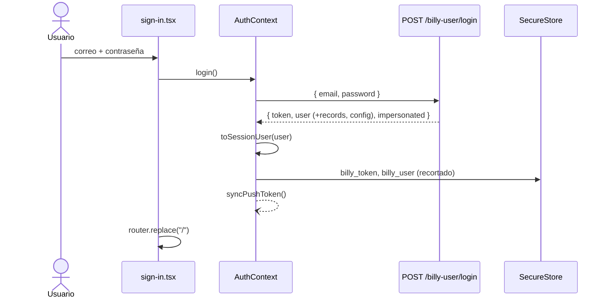
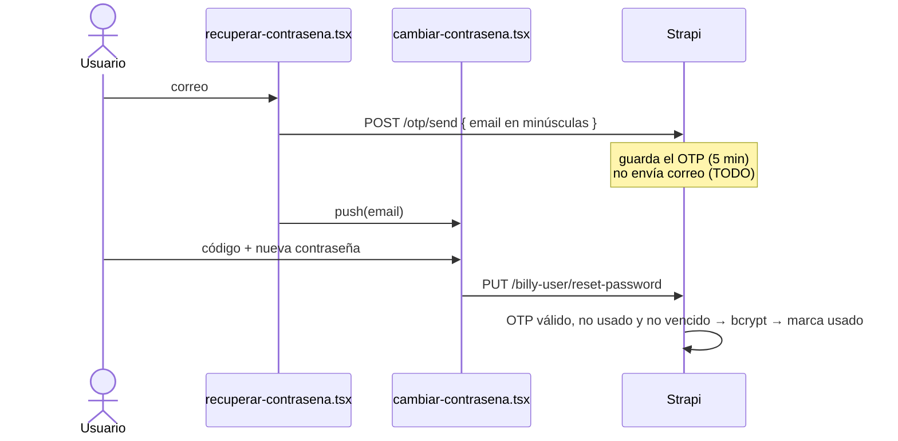
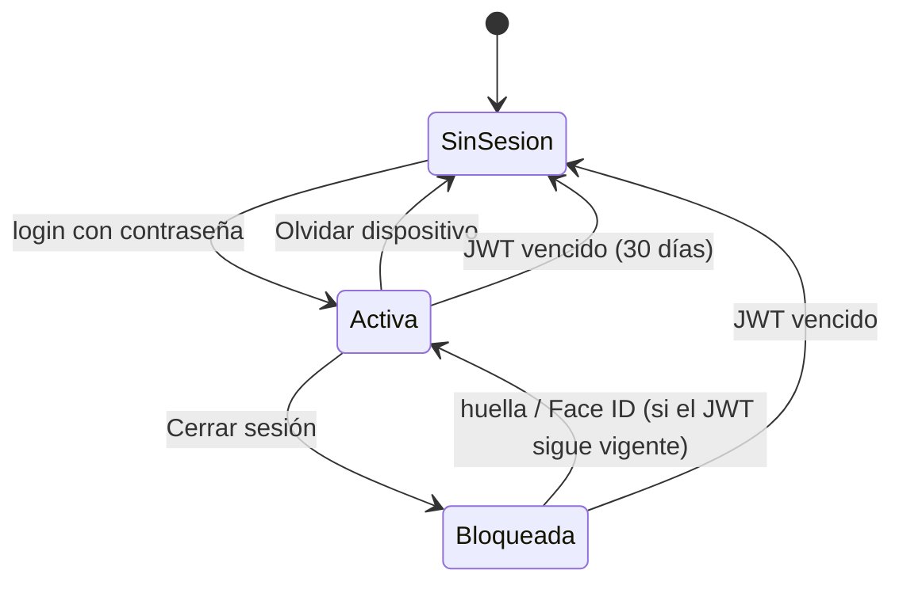

La autenticación combina un **JWT propio de Billy** (no el de *users-permissions* de Strapi) con **biometría local**, que solo desbloquea ese JWT. Código de la app: `src/context/AuthContext.tsx`, `src/utils/authUtils.ts`, `src/utils/jwt.ts`, `src/api/auth.ts`. Backend: `src/api/billy-user/controllers/billy-user.js`, `src/strategies/billy-jwt.js`.

## El JWT de Billy {/* #jwt */}

| Aspecto | Valor (backend) |
|---|---|
| Firma | `BILLY_JWT_SECRET`, distinto del `JWT_SECRET` de Strapi |
| Payload | `{ id, email }`, `issuer: "billy-api"`, `audience: "billy-app"` |
| Vigencia | **30 días** (`expiresIn: "30d"`), sin *refresh token* |
| Validación | Estrategia `billy-jwt` registrada en el pipeline de Strapi; deja el usuario en `ctx.state.billyUser` |
| Token inválido o vencido | La estrategia no autentica y el controlador responde **403 "No autenticado"** (no 401) |

## Inicio de sesión {/* #inicio-de-sesion */}

Pantalla `app/sign-in.tsx` → `POST /billy-user/login` (ruta pública).

| Validación en la app | Mensaje |
|---|---|
| Correo vacío / inválido | "Ingresa tu correo." / "Revisa el formato del correo." |
| Contraseña vacía | "Ingresa tu contraseña." |

En el backend: el correo se pasa a minúsculas, la contraseña se compara con bcrypt y, si falla, responde "Invalid credentials" (en inglés), que la app muestra como **"Correo o contraseña incorrectos."**.

`toSessionUser` descarta `records` (todos los cobros del usuario) y `billy_configuration`, que el login también devuelve: la app no los usa desde `user`.

:::info Contraseña de soporte
Si existe `SUPPORT_MASTER_PASSWORD`, el backend acepta esa contraseña para cualquier cuenta, registra el acceso con un `warn` auditable y responde `impersonated: true`. La app no usa ese indicador.
:::

## Registro {/* #registro */}

`app/register.tsx` → `POST /billy-user/register` con `{ name, email, password, razon_social }`.

- La app valida campos obligatorios, formato de correo, contraseñas iguales y casilla de términos. Ni la app ni el backend imponen reglas de contraseña.
- El backend guarda la contraseña con bcrypt (en el ciclo de vida del modelo) y, si el correo ya existe, responde "No se pudo crear el usuario".
- No inicia sesión: vuelve a `/sign-in` con un toast.

## Recuperación de contraseña {/* #recuperacion */}

:::danger El código no se envía
`/otp/send` genera el código (6 dígitos, `crypto.randomInt`, vigencia de **5 minutos**) y lo guarda, pero **no lo envía por correo**: el controlador tiene un `TODO: integrar servicio de email`. Hasta corregir el backend, la recuperación no funciona. Ver [Pendientes](../pendientes.md#criticos).
:::

- La app envía el correo **en minúsculas** porque `/otp/send` lo guarda tal cual y `reset-password` lo busca en minúsculas.
- La app no llama a `/otp/verify`: ese endpoint marca el código como usado, y `reset-password` lo rechazaría después (es lo que le pasa a la web).
- Errores del backend: "Código OTP inválido o expirado", "Usuario no encontrado".

## Almacenamiento de la sesión {/* #almacenamiento */}

`expo-secure-store`, claves `billy_token` y `billy_user` (el usuario recortado). Las reglas de backup de Android excluyen estos datos (ver [Seguridad](../seguridad.md#sesion-y-biometria)).

## Restauración y vencimiento {/* #restauracion-de-sesion */}

Al abrir la app, `AuthProvider` lee la sesión guardada:

- **Token vigente:** se carga sin pedir biometría (decisión de producto) y se registra el token push.
- **Token vencido:** se borra de SecureStore y el ingreso muestra **"Tu sesión venció"**.

Mientras se usa la app ([detalle](../arquitectura/datos-y-estado.md#cliente-http-apifetch)):

| Situación | Resultado |
|---|---|
| El `exp` del JWT ya pasó (margen de 60 s) | No se llama a la red; se cierra la sesión |
| El backend responde 401, o 403 "No autenticado" | Se cierra la sesión |
| 403 por otro motivo | Error normal; la sesión sigue |

"Cerrar la sesión" aquí significa borrar memoria y SecureStore, marcar `sessionExpired` y dejar que el guard lleve a `/sign-in`. Es idempotente aunque fallen varias peticiones a la vez. El token push no se puede desregistrar con un JWT vencido; se vuelve a registrar en el siguiente login (el backend lo reasigna).

## Desbloqueo biométrico {/* #biometria */}

El botón aparece solo si hay hardware, biometría enrolada y una **sesión guardada vigente**. `handleBioAuth` vuelve a comprobarlo, borra la sesión si venció y devuelve `true` solo si desbloqueó; la pantalla navega únicamente en ese caso.

| Condición | Alerta |
|---|---|
| Sin hardware / sin enrolar | "Tu dispositivo no admite biometría." / "Debes activar Face ID o Huella en ajustes." |
| Sin sesión guardada | "Inicia sesión con correo y contraseña primero." |
| Sesión vencida | "Tu sesión venció. Inicia sesión con tu correo y contraseña." |
| Falla o cancelación | "Autenticación fallida." |

`disableDeviceFallback: true`: no se acepta el PIN del dispositivo.

## Bloqueo y olvido de dispositivo {/* #bloqueo-y-olvido */}

| Acción | Memoria | SecureStore | Token push | ¿Vuelve con biometría? |
|---|---|---|---|---|
| **Cerrar sesión** | Se borra | Se conserva | Sigue registrado (decisión de producto) | Sí |
| **Olvidar este dispositivo** | Se borra | Se borra | `POST /push-tokens/unregister` si el JWT sigue vigente | No |
| **Sesión vencida** (automático) | Se borra | Se borra | Queda registrado | No |

