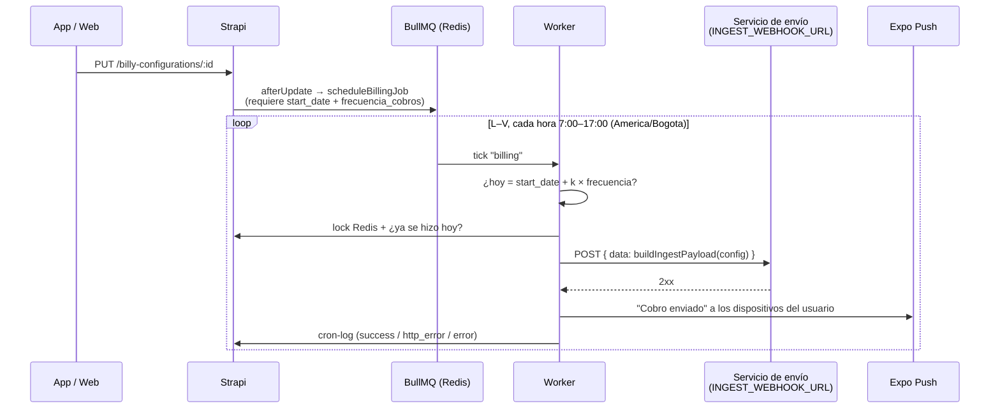

Las pantallas de `app/(app)/config/` editan la **configuración de Billy** del usuario (`billy-configuration`). La app no envía mensajes: el backend programa los cobros y entrega la configuración a un servicio de envío externo.

## Cómo se ejecuta un cobro {/* #ejecucion */}

Verificado en `gcp-strapi-billy` (`src/cron/scheduler.js`, `worker/cron-worker.js`, `cron-logic.js`):

Reglas:

- **Sin `start_date` o sin `frecuencia_cobros` no se programa nada** (el backend registra "Job no agendado"). La web pide la fecha ("¿Cuándo quieres realizar el próximo lote de cobros?"); **la app todavía no** (ver [Pendientes](../pendientes.md#funcionalidad)).
- Es día de cobro cuando los días desde `start_date` son un múltiplo no negativo de `frecuencia_cobros`.
- Como mucho un envío por configuración y día (marca en Redis durante 24 h).
- Si `billy_active === false`, se omite. La app no expone este campo.
- La push solo sale si el servicio de envío responde 2xx.

## Persistencia

- Una configuración por usuario. `getMyConfig` toma `data[0]` de `GET /billy-configurations` (el backend filtra por dueño).
- `useBillyConfig().save()` hace `POST` o `PUT` **con el mismo `populate` que el `GET`**, para que la respuesta conserve tonos e imágenes ([Datos y estado](../arquitectura/datos-y-estado.md#usebillyconfig)).
- **Guardar** se habilita solo si hubo cambios.

## Ajustes generales {/* #ajustes-generales */}

Pantalla `config/index.tsx`.

| Campo | Atributo | Validación en la app | Uso en el backend |
|---|---|---|---|
| Correo remitente | `canal_correo` | Formato de correo | Enviado al servicio de envío |
| Frecuencia de cobros (días) | `frecuencia_cobros` (string) | Solo dígitos | Intervalo del programador |
| Link de pago | `link_pago` | — | Enviado al servicio de envío |
| Link del Excel en Drive | `link_drive` | — | Enviado al servicio de envío |
| Pruebas: correo, SMS, WhatsApp | `test_email`, `test_phone`, `test_whatsapp` | Formato del correo | Enviados al servicio de envío |
| "La mayoría de mis clientes son empresas" | `client_type` | — | Enviado como booleano |

Campos que existen en el backend y la app no edita: `start_date`, `billy_active`, `canal_sms`, `copymessage` (se envían al servicio) y `fee_collection` (no se envía).

## Tonos y canales {/* #tonos */}

Pantalla `config/tonos.tsx`. Cuatro tonos independientes (`amigable`, `formal`, `exigente`, `con_plantilla`), cada uno con `active`, `canales` (`email`, `sms`, `whatsapp`), `notas` y `filters` (la app conserva `filters`, pero no los edita).

| Tono | Canales en la app | Notas | Motivo |
|---|---|---|---|
| Amigable, Formal, Exigente | Email, SMS, WhatsApp | Sí | — |
| Con plantilla | Email, SMS | No | `buildIngestPayload` descarta su WhatsApp y sus notas: envía la plantilla de correo tal cual. |

## Plantilla de correo {/* #plantilla */}

Pantalla `config/plantilla.tsx`. Strapi guarda `plantilla_correo` como *blocks*; la app lo edita como texto plano:

- `blocksToPlainText`: un bloque por línea, recorre los nodos anidados (el texto de los enlaces se conserva) y pone cada ítem de lista en su propia línea.
- `plainTextToBlocks`: cada línea pasa a un párrafo.

:::warning Se pierde el formato enriquecido
Guardar desde la app convierte la plantilla en párrafos de texto: se pierden negritas, enlaces (queda su texto) y listas. La pantalla lo advierte.
:::

### Variables {/* #variables */}

Mismo formato y lista que el editor de la web (`Billy_v2/configuration.php`): **una sola llave**. Se insertan en la posición del cursor.

| Variable | Etiqueta |
|---|---|
| `{client_name}` | Nombre del deudor |
| `{client_email}` | Correo del deudor |
| `{client_phone}` | Teléfono del deudor |
| `{invoice_number}` | N.º de factura |
| `{invoice_due_date}` | Vencimiento |
| `{invoice_stage}` | Etapa |
| `{invoice_days_outstanding}` | Días en mora |
| `{invoice_amount}` | Valor |
| `{current_date}` | Fecha actual |

:::caution Plantillas guardadas con la versión anterior
Hasta el commit `2bfc839`, la app insertaba `{{client_name}}` (dos llaves). Las plantillas guardadas así desde la app deben corregirse a mano. El reemplazo lo hace el servicio de envío, que está fuera de estos repositorios.
:::

## Imágenes {/* #imagenes */}

Pantalla `config/imagenes.tsx`: `cabecera_correo`, `firma_correo` y `avatar_billy`.

1. Pide permiso de galería (`expo-image-picker`; la cámara y el micrófono están desactivados).
2. Sube el archivo a `POST /upload` (multipart).
3. Guarda el `id` del archivo en la configuración con `PUT … ?populate=…`. La respuesta trae el medio, así que la vista previa se actualiza sin recargar.

El backend envía al servicio de envío solo el `id` de cada imagen (`pickMediaId`). Reemplazar una imagen no borra la anterior de la biblioteca de medios.
