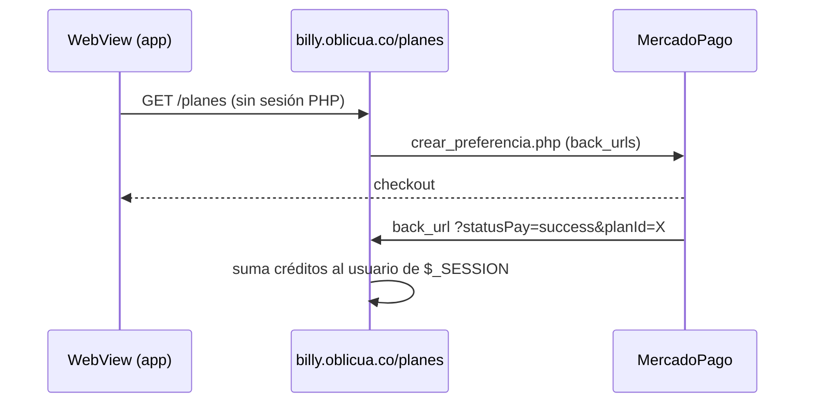

## Pestaña Cuenta {/* #cuenta */}

Pantalla `app/(app)/(tabs)/cuenta.tsx`. Carga el perfil (`getMe`) y la configuración (`getMyConfig`, cuyo error se ignora).

| Bloque | Contenido | Destino |
|---|---|---|
| Encabezado | Avatar, nombre y razón social | `/perfil` |
| Tarjeta de plan | Plan, saldo o "Ilimitado", barra y **Recargar** | `/mi-plan`, `/planes` |
| Cobranza automática | Ajustes generales · Tonos y canales ("N de 4 activos") · Plantilla · Imágenes | `/config/*` |
| Cuenta | Perfil · Mi plan y créditos · Centro de ayuda · Olvidar este dispositivo | — |
| Pie | **Cerrar sesión** y el correo | — |

"Cerrar sesión" y "Olvidar este dispositivo": ver [Autenticación](./autenticacion.md#bloqueo-y-olvido).

## Perfil {/* #perfil */}

`app/(app)/perfil.tsx` → `PUT /billy-users/:documentId` con `{ name, razon_social, nit }`.

- El correo no se puede cambiar.
- El backend ignora `password`, `balance` y `plan` si llegan en el cuerpo, y solo permite editar la propia cuenta.
- Al guardar, la app también actualiza `user` en memoria y en SecureStore (`updateUser`), así el saludo de Inicio muestra el nombre nuevo.

## Mi plan y créditos {/* #mi-plan */}

`app/(app)/mi-plan.tsx`: `getMe` (con `plan`) y `GET /credits` (por vencimiento ascendente, hasta 100).

### Cómo se crean y consumen los créditos

Verificado en la web y el backend:

- **Compra** (web, `plans.php`): suma `plan.credits` a `billy_user.balance`, asigna el plan y crea un lote `credit` con `expiration_date` a **3 meses**.
- **Consumo** (`POST /credits/use`): descuenta de los lotes con `status: true`, del más próximo a vencer al más lejano; un lote que llega a 0 queda `status: false`. **No actualiza `balance`**.
- **Vencimiento:** ningún proceso marca lotes por fecha y `useCredits` también consume lotes vencidos (ver [Pendientes](../pendientes.md#criticos)).

### Estado de cada lote

`creditState` (`src/utils/credits.ts`):

| Condición | Badge |
|---|---|
| `status = false` | Agotado |
| Fecha de vencimiento pasada | Vencido |
| Vence en 0–4 días | Por vencer |
| Resto | Activo |

Si hay lotes por vencer, un `Banner` suma sus cantidades.

### Saldo {/* #saldo */}

La app muestra `billy_user.balance` ("Ilimitado" si `plan.isSuscription`). En la web, Mi plan muestra lo mismo, pero el dashboard muestra `balance − total de records`. Como `useCredits` no descuenta de `balance`, el valor es ambiguo: queda pendiente definir qué es "saldo disponible" ([Pendientes](../pendientes.md#funcionalidad)).

## Recarga de saldo {/* #recarga */}

`app/(app)/planes.tsx`: `WebView` a `https://billy.oblicua.co/planes`.

:::danger Riesgos verificados en la web
- Los créditos se acreditan al llegar a `?statusPay=success&planId=X`, **sin verificar el pago** con MercadoPago.
- El acreditamiento usa la sesión PHP; el WebView de la app no la tiene, así que una compra desde la app **probablemente no acredita** salvo que el usuario inicie sesión en la web dentro del WebView. Hay que probarlo de punta a punta.

Ver [Pendientes](../pendientes.md#criticos).
:::

La pantalla muestra un indicador hasta `onLoadEnd` y un `ErrorState` con reintento ante errores. Al volver, el saldo se actualiza con pull-to-refresh.

## Centro de ayuda {/* #faq */}

`app/(app)/faq.tsx` → `GET /faqs` (controlador estándar de Strapi; para el rol *Public* depende de los permisos del panel). Campos `Pregunta` y `Respuesta`; búsqueda local sin tildes (`normalizeSearch`); acordeón accesible.
