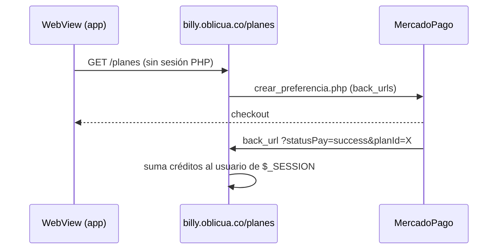

## Pestaña Cuenta {/* #cuenta */}

Pantalla `app/(app)/(tabs)/cuenta.tsx`. Carga el perfil (`getMe`) y la configuración (`getMyConfig`, cuyo error se ignora).

| Bloque | Contenido | Destino |
|---|---|---|
| Encabezado | Avatar, nombre y razón social | `/perfil` |
| Tarjeta de plan | Plan, saldo o "Ilimitado", barra y **Recargar** | `/mi-plan`, `/planes` |
| Cobranza automática | Ajustes generales · Tonos y canales ("N de 4 activos") · Plantilla · Imágenes | `/config/*` |
| Cuenta | Perfil · Mi plan y créditos · Centro de ayuda · Olvidar este dispositivo | — |
| Pie | **Cerrar sesión** y el correo | — |

"Cerrar sesión" y "Olvidar este dispositivo": ver [Autenticación](./autenticacion.md#bloqueo-y-olvido).

## Perfil {/* #perfil */}

`app/(app)/perfil.tsx` → `PUT /billy-users/:documentId` con `{ name, razon_social, nit }`.

- El correo no se puede cambiar.
- El backend ignora `password`, `balance` y `plan` si llegan en el cuerpo, y solo permite editar la propia cuenta.
- Al guardar, la app también actualiza `user` en memoria y en SecureStore (`updateUser`), así el saludo de Inicio muestra el nombre nuevo.

## Mi plan y créditos {/* #mi-plan */}

`app/(app)/mi-plan.tsx`: `getMe` (con `plan`) y `GET /credits` (por vencimiento ascendente, hasta 100).

### El libro de créditos {/* #libro-de-creditos */}

Rediseñado en `gcp-strapi-billy` (`api::credit.credit`, commit `d389e97`): cada `credit` es un **lote** con `amount` (total acreditado), `used` (mensajes ya consumidos) y `source` (`purchase`, `gift`, `adjustment` o `migration`). Disponible de un lote = `amount − used`.

- **Compra** (web, `plans.php`): crea un lote `source: "purchase"` con `expiration_date` a 3 meses.
- **Consumo automático:** cada mensaje de cobro que el backend registra (`record.create`, `/records/create-multiple`, `/create-bulk-entries` — toda ruta que crea un *record*) descuenta **1 crédito** del lote más próximo a vencer (FIFO), con un `UPDATE` atómico y condicionado para que dos envíos simultáneos no gasten el mismo crédito dos veces. Sin saldo, el mensaje se envía igual y el faltante queda en los logs del backend — nunca bloquea un cobro ya salido.
- **`billy_user.balance`** (el campo que lee la app) se recalcula solo —`credit.service.syncUserBalance`— cada vez que cambia un lote: al crearlo, editarlo, borrarlo o consumir de él. Es la suma de lo disponible en los lotes vigentes del usuario; los planes `isSuscription` (ilimitados) no consumen nunca.
- **Vencimiento:** un job diario (00:10 América/Bogotá, `credits-expire`) marca `status: false` los lotes vencidos y resincroniza el saldo de sus dueños.
- `POST /credits/use` sigue existiendo para ajustes manuales explícitos (o desde un Strapi API Token); el consumo normal por mensajes enviados ya no pasa por ahí.

### Estado de cada lote

`creditState` y `availableOf` (`src/utils/credits.ts`), a partir de `status` **y** de cuánto queda disponible:

| Condición | Badge |
|---|---|
| `status = false` y disponible = 0 | Agotado |
| `status = false` pero todavía quedaba saldo (lo marcó el job de vencimiento) | Vencido |
| `status = true` y la fecha ya pasó | Vencido |
| Vence en 0–4 días | Por vencer |
| Resto | Activo |

Cada fila del historial muestra "N de M disponibles" (no el total original) y, si no es una compra, su origen (Regalo, Ajuste, Saldo anterior). Si hay lotes por vencer, el `Banner` suma lo **disponible** de esos lotes, no su monto bruto.

### Saldo {/* #saldo */}

La app muestra `billy_user.balance`, que ahora el backend mantiene sincronizado con la suma de los lotes vigentes ("Ilimitado" si `plan.isSuscription`). El dashboard de la web sigue restando `total de records`, una cuenta aparte heredada de antes del libro de créditos — con el consumo automático ya no debería ser necesaria, pero no se tocó la web en este cambio.

### Migración de datos existentes {/* #migracion-de-creditos */}

`scripts/migrate-credits-ledger.js` (en `gcp-strapi-billy`) rellena `used`/`source` en los lotes creados antes del libro de créditos, a partir del `balance` legado y de los *records* ya enviados. Simulación por defecto; `--apply` para escribir. Verificado idempotente (simulación → aplicar → simulación da el mismo resultado) sobre una copia de la base de desarrollo.

## Recarga de saldo {/* #recarga */}

`app/(app)/planes.tsx`: `WebView` a `https://billy.oblicua.co/planes`.

:::danger[Riesgos verificados en la web]
- Los créditos se acreditan al llegar a `?statusPay=success&planId=X`, **sin verificar el pago** con MercadoPago.
- El acreditamiento usa la sesión PHP; el WebView de la app no la tiene, así que una compra desde la app **probablemente no acredita** salvo que el usuario inicie sesión en la web dentro del WebView. Hay que probarlo de punta a punta.

Ver [Pendientes](../pendientes.md#criticos).
:::

La pantalla muestra un indicador hasta `onLoadEnd` y un `ErrorState` con reintento ante errores. Al volver, el saldo se actualiza con pull-to-refresh.

## Centro de ayuda {/* #faq */}

`app/(app)/faq.tsx` → `GET /faqs` (controlador estándar de Strapi; para el rol *Public* depende de los permisos del panel). Campos `Pregunta` y `Respuesta`; búsqueda local sin tildes (`normalizeSearch`); acordeón accesible.
