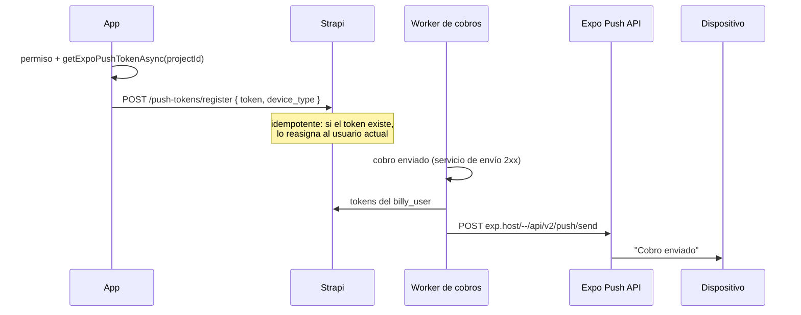

## De punta a punta

## En la app

`registerForPushNotificationsAsync` (`src/utils/pushNotifications.ts`):

1. Carga `expo-notifications` con `require` dentro de `try/catch`, para no romper el arranque en Expo Go Android.
2. Configura la visualización en primer plano (banner, lista, sonido, badge) y, en Android, el canal `default` (importancia MAX, luz `#6D58FF`).
3. Pide permiso; sin permiso devuelve `null`.
4. Obtiene el `ExpoPushToken` con `extra.eas.projectId`.

`syncPushToken` corre sin bloquear tras restaurar la sesión, iniciar sesión o desbloquear con biometría.

| Acción | Efecto en el token |
|---|---|
| Cerrar sesión | Ninguno: el dispositivo bloqueado sigue recibiendo avisos (decisión de producto) |
| Olvidar este dispositivo | `POST /push-tokens/unregister` (si el JWT sigue vigente) |
| Sesión vencida | Queda registrado; se reasigna en el siguiente login |

## En el backend

Verificado en `gcp-strapi-billy`:

- `push-token.register` exige un usuario autenticado, rechaza la petición sin `token` y **reasigna** un token existente al usuario actual (cubre el cambio de cuenta en el mismo dispositivo).
- `sendPushToUser` (`src/utils/push.js`) busca todos los tokens del usuario y los manda en un solo `POST` a la Expo Push API, sin credenciales propias. Nunca lanza errores: un fallo de push no afecta al cobro.
- **Único disparador hoy:** el cobro automático exitoso (`executeJob`), con título "Cobro enviado", cuerpo "Billy acaba de enviar un cobro automático a tus deudores." y `data: { type: "billing-success", config_id }`.
- No procesa los *tickets* de respuesta de Expo: los tokens inválidos (`DeviceNotRegistered`) no se eliminan.

La app no escucha toques en la notificación, así que abrirla lleva a la pantalla inicial.

## Requisitos por plataforma

| Plataforma | Requisito | Estado |
|---|---|---|
| Android | FCM: `google-services.json` + credenciales FCM V1 en EAS | El archivo está ignorado por git; en EAS se carga como variable de archivo `GOOGLE_SERVICES_JSON` (ver [Builds](../despliegue/builds-y-publicacion.md#variables-en-eas)). |
| iOS | Credenciales APNs en EAS | Sin verificar. |
| Expo Go Android | — | No soporta push remotas; la app lo tolera. |
