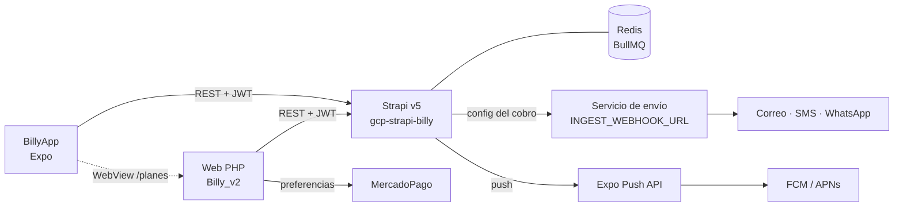

## Mapa del ecosistema

| Servicio | Repositorio / ubicación | Cómo se integra |
|---|---|---|
| [Strapi](#strapi) | `B:\repos\gcp-strapi-billy` | REST; `EXPO_PUBLIC_API_BASE_URL` |
| [Programador de cobros](#cron) | Mismo repositorio (`src/cron`, `worker/`) | BullMQ sobre Redis, dentro del proceso de Strapi |
| [Servicio de envío](#ingest) | Externo (GCP) | Webhook `INGEST_WEBHOOK_URL` |
| [Expo Push](#push) | Expo | `exp.host/--/api/v2/push/send` |
| [Web y MercadoPago](#mercadopago) | `D:\NAS_DATA\Code\Clientes\Oblicua\Billy_v2` | WebView a `/planes` |
| [EAS](#eas) | Expo | CLI, cuenta `jdd95` |

## Strapi {/* #strapi */}

Strapi **5.33.4** (Node), desplegado en GCP (`Dockerfile`, `cloudbuild.yaml`, `DEPLOY.md`). Rutas personalizadas: `/billy-user/*`, `/otp/*`, `/push-tokens/*`, `/credits/use`, `/credits/expiring/:userId` y varias de carga masiva de facturas y registros. Autenticación con la estrategia `billy-jwt`; autorización por dueño ([Seguridad](./seguridad.md#autorizacion)). Contrato usado por la app en [API del backend](./datos/api-backend.md).

## Programador de cobros {/* #cron */}

- Cada configuración tiene un *job scheduler* de BullMQ con patrón `0 7-17 * * 1-5` y zona `America/Bogota`.
- Se crea o actualiza en los ciclos de vida `afterCreate`/`afterUpdate` de `billy-configuration`, **sólo si `billy_active === true`** (si no, se elimina el scheduler en vez de crearlo — antes se agendaba igual y recién el siguiente reinicio lo corregía), y se elimina en `beforeDelete`.
- **Requiere `start_date` y `frecuencia_cobros`**; sin ellos no se programa. La app ya permite editar `start_date` ([Ajustes generales](./funcionalidades/cobranza-automatica.md#ajustes-generales)).
- Locks y marcas de "hecho hoy" en Redis; cada ejecución queda en `cron-log` (`success`, `http_error` o `error`).
- Las campañas (función solo web) tienen su propio *job* y webhook (`CAMPAIGN_INGEST_WEBHOOK_URL`).
- Un *job* diario aparte, `credits-expire` (00:10 América/Bogota), marca vencidos los lotes de créditos y resincroniza saldos — ver [el libro de créditos](./funcionalidades/cuenta-y-plan.md#libro-de-creditos).
- `BILLY_SCRIPT=1` desactiva el agendado y el *worker* de BullMQ al cargar Strapi: lo usan los scripts de mantenimiento (p. ej. `scripts/migrate-credits-ledger.js`) para no disparar cobros reales al arrancar.

Flujo detallado en [Cobranza automática](./funcionalidades/cobranza-automatica.md#ejecucion).

## Servicio de envío {/* #ingest */}

Strapi le envía `{ data: buildIngestPayload(config) }`: tonos (en `con_plantilla`, sin WhatsApp ni notas), `client_type`, canales, `link_pago`, `frecuencia_cobros`, `plantilla_correo` (blocks), `link_drive`, `start_date`, destinos de prueba, `copymessage`, campañas, la primera integración del usuario (`platform`, `apiLink`, `data_connection`) e `id` de cabecera, firma y avatar.

Ese servicio envía los mensajes, reemplaza las [variables de la plantilla](./funcionalidades/cobranza-automatica.md#variables) y crea los *records*. **Su código no está en ninguno de los tres repositorios.**

## Expo Push {/* #push */}

El backend envía las notificaciones directamente a la Expo Push API, sin credenciales propias. Detalle en [Notificaciones push](./funcionalidades/notificaciones-push.md).

## Web y MercadoPago {/* #mercadopago */}

La web (PHP sin base de datos local, con un SDK `Billy` sobre cURL contra la misma API) maneja la compra de planes:

1. `crear_preferencia.php` crea la preferencia con `back_urls` a `/planes?statusPay=…&planId=…`.
2. Al volver con `success`, `plans.php` suma `plan.credits` a `balance`, asigna el plan y crea un lote de créditos que vence en 3 meses, **para el usuario de la sesión PHP**.

La app abre `/planes` en un WebView sin sesión web. Riesgos en [Cuenta y plan](./funcionalidades/cuenta-y-plan.md#recarga) y [Pendientes](./pendientes.md#criticos).

## EAS {/* #eas */}

Proyecto con `projectId` en `app.json` (cuenta `jdd95`). `app.config.js` lee `GOOGLE_SERVICES_JSON` del entorno de EAS. Ver [Builds y publicación](./despliegue/builds-y-publicacion.md).

## Capacidades del dispositivo

| Módulo | Uso |
|---|---|
| `expo-secure-store` | JWT y usuario |
| `expo-local-authentication` | Huella / Face ID |
| `expo-image-picker` | Galería (sin cámara ni micrófono) |
| `expo-notifications` | Push |

## Sin integrar

Sin analítica, reporte de fallos, *feature flags* ni OTA (`expo-updates`).
